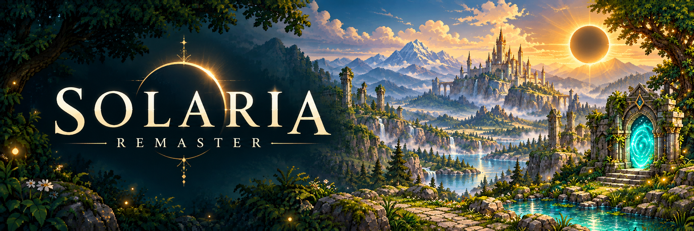

**[開始遊玩](https://sces5504.github.io/Solaria-Remaster/)** · [下載離線版](https://github.com/sces5504/Solaria-Remaster/releases/latest) · [版本歷程](CHANGELOG.md)

  

# 日蝕之後，循光而行

Solaria Remaster 是一款供桌面鍵鼠遊玩的單人像素風俯視角動作 Roguelike。你將扮演踏入暮光的旅人，在怪潮、彈幕與領主的追擊之間尋找生路，沿途拾取裝備、選擇卡片，逐漸磨出屬於自己的戰鬥方式。

> 日蝕吞沒了天空，秘境卻沒有迎來長夜的寧靜。\
> 草木仍在生長，群星仍在墜落，而失落的日光，正沉睡於旅途的盡頭。

## 踏上尋光之旅

- **六重秘境，每趟不同。** 每次出發，九種地形中將有六種串起旅程。穿過林庭、雪原與熔岩之地，完成三十道試煉，再向索拉里斯神發起挑戰。同名秘境也有不同的景致與路徑；節慶災厄、血月與天外來客，可能讓熟悉的旅途生出變數。
- **卡片與元素，交織構築。** 升級時，從三張卡片中選擇下一份力量。普攻、職業技能與裝備可以彼此呼應，元素也會改變戰鬥的節奏。通常最多只能覺醒兩種元素；選擇的不只是力量，也決定了這趟旅程將捨棄什麼。
- **讀懂殺招，再迎向下一周目。** 留意地面預警、善用掩體，別把閃避當成無敵。若能奪回日光，便可保留這身力量踏入下一周目，迎戰更加兇險的秘境。

## 選擇你的旅人

三種職業，各有立足於險境的方法：

- **劍士**：體魄堅韌，以精準格擋迎住攻勢，在反擊的片刻斬開重圍。
- **弓箭手**：擅長密集而迅捷的射擊，在走位之間持續壓制敵人。
- **法師**：以強勁、頻繁的職業法術掌控戰局，讓追兵止步於咒光之中。

## 開始遊玩

直接開啟[線上版](https://sces5504.github.io/Solaria-Remaster/)，或從[最新發行版本](https://github.com/sces5504/Solaria-Remaster/releases/latest)下載 HTML 檔，以瀏覽器開啟即可離線遊玩，無須安裝或啟動伺服器。請使用電腦、鍵盤與滑鼠；首次啟程會開啟旅人手冊，旅途中也能隨時查閱。

| 操作       | 按鍵     |
| ---------- | -------- |
| 移動       | WASD     |
| 瞄準       | 滑鼠     |
| 普通攻擊   | 滑鼠左鍵 |
| 職業技能   | 滑鼠右鍵 |
| 閃避       | 空白鍵   |
| 拾取／進門 | E        |
| 裝備整備   | I        |
| 查看構築   | C        |
| 暫停       | Esc      |

進度自動保存在目前瀏覽器；戰鬥中重新載入會回到本房入口。可從暫停選單匯出存檔備份，再於主選單匯入，讓線上版與下載版接續同一趟旅程。

---

製作者：**Mori Fang**
